# clawd-companion

Clawd, Claude Code's pixel mascot, moves into your VS Code chat panel. He stands on the input box and acts out
what Claude is doing, with 95 pixel-art animations, and he's not just decoration: throw him around and he climbs
back up, poke him and he reacts, click him and he answers your side questions.

<p align="center">
  
  
  
  
</p>
<p align="center">
  
  
  
  
</p>
<p align="center">
  ▶ <b>Watch the showcase video:</b> <a href="video/clawd-companion-16x9.mp4">16:9 (1:49)</a> · <a href="video/clawd-companion-9x16.mp4">9:16 (48 s)</a>
</p>

> **Unofficial fan project.** Not made, endorsed or supported by Anthropic. Clawd and Claude are Anthropic's.
> This repository contains none of Anthropic's code: it patches the copy of the Claude Code extension that you
> already have installed, on your own machine.

## What he does

| When | Clawd |
|---|---|
| you open the panel | says hello (3 versions) |
| nothing's happening | idles: a firefly, a kite, a kitten, a bird, bubbles, a garden, a handheld game, moods (8 scenes, rotating) |
| you type | juggles your letters, drums along, or takes notes (3 versions) |
| Claude is thinking | ponders by candlelight, or a chalkboard, puzzle cube, constellations, gears, pacing, stacking stones (7 scenes, rotating) |
| Claude is working | codes, cooks, forges, runs a lab, knits, paints, sorts mail (7 scenes, rotating) |
| subagents are running | captains a crew of mini Clawds |
| Claude asks you something | holds up a question (3 versions) |
| it needs your permission | rings a bell, waves flags (3 versions) |
| the turn is done | celebrates (3 versions, a party after long turns) |
| compacting, hooks, errors, rate limits | each has its own scene |
| you switch permission mode | shows the mode (manual, plan, accept edits, auto, bypass) |
| nothing for 5 minutes | falls asleep (3 versions) |

Scenes never pop in or out: each one sets up when it starts (props drop in and land) and packs away when it ends,
and he walks a few steps between scenes.

## Play with him

- **Click him**: his speech bubble opens. It's Claude Code's own `/btw` side question, so you can ask Claude
  something without interrupting the conversation. He listens while you type, thinks while it answers, and
  presents the answer. Clicking him while the bubble is open pokes him (12 reactions; three quick clicks make
  him dizzy).
- **Drag him**: he dangles. Hold him still and he gets bored; shake him and he gets dizzy.
- **Throw him**: he tumbles, bounces off the walls and crashes. Let go high up and his parachute opens; click
  the parachute and it pops.
- **Drop him beside the input box**: he falls to the bottom of the panel, looks up, walks up the side of the box
  like a crab and flips back on top.
- **Hover him**: he notices you. Move the cursor back and forth over him to pet him.
- Left alone, he wanders along the box, sits on its edge with his legs dangling, and now and then hops off.

The patch also restyles the input footer: an always-on context meter (click to compact), session and weekly
usage bars, a subagents counter, an effort slider and an Ultracode switch.

## Try it in your browser first

The playground runs the real code on a mock of the chat panel, with buttons that fake what Claude is doing.
No VS Code needed:

```sh
cd extension
npm run playground        # writes extension/playground/index.html: open it in a browser
```

## Install

You need VS Code with the [Claude Code extension](https://marketplace.visualstudio.com/items?itemName=anthropic.claude-code)
installed, Node 18 or newer, and `zip` (built into macOS and most Linux). Tested on macOS.

```sh
git clone https://github.com/workordie/clawd-companion.git
cd clawd-companion/extension
npm run build             # copies YOUR installed Claude Code, patches it, packs dist/claude-code-custom-<version>.vsix
npm run install-vsix      # installs that build in place of the marketplace copy
```

Then in VS Code: `Cmd/Ctrl+Shift+P` → **Developer: Reload Window**.

- **Turn off auto-update for Claude Code** (Extensions view → Claude Code → gear → Auto Update), or the next
  release replaces the custom build. After a Claude Code update, install it from the marketplace and run
  `npm run build && npm run install-vsix` again.
- **Changed something?** `npm run sync` copies `custom/` and the animations into the installed build; then
  Reload Window.
- **To undo it**, reinstall Claude Code from the marketplace.
- **Don't share the built `.vsix`**: it contains Anthropic's extension code. Share this repository instead.

## Make your own animation

Every animation is a small Python file that draws pixel frames with a toolkit (`animations/gen/clawdlib.py`,
plus a library of 225 hats, props and effects). Copy the example, preview it as a contact sheet, build it, and
try it in the playground. Name it `<state>-<anything>` (for example `working-dj`) and it joins that state's
rotation automatically.

Start here: [docs/add-an-animation.md](docs/add-an-animation.md). The art rules (Clawd never shrinks, plain
black eyes, no mouth) are in [animations/gen/STYLE.md](animations/gen/STYLE.md).

## How it works

The patch adds two files to the extension's chat webview, `custom.js` and `custom.css`. The script reads the
messages the extension already sends its chat panel to know what Claude is doing, and swaps Clawd's animated SVG
to match. Details: [docs/how-it-works.md](docs/how-it-works.md).

## Layout

| Folder | What |
|---|---|
| `animations/` | the generator (Python), the art rules, and the built animations (`svg/`, `svg-tx/` for set-up/pack-away clips) |
| `extension/` | the patcher (`npm run build / install-vsix / sync / playground`) and `custom/custom.js` + `custom.css` |
| `docs/` | how it works, how to add an animation |
| `video/` | the showcase video (16:9 and 9:16) and its source |

## Contributing

Ideas, new animations and fixes are welcome: see [CONTRIBUTING.md](CONTRIBUTING.md).

## License

The code and the animations' source in this repository are MIT licensed ([LICENSE](LICENSE)). Clawd and Claude
are Anthropic's trademarks; this license doesn't grant any rights to them.
